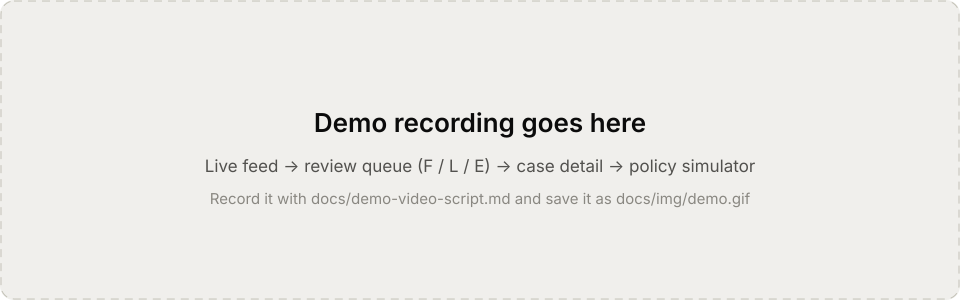
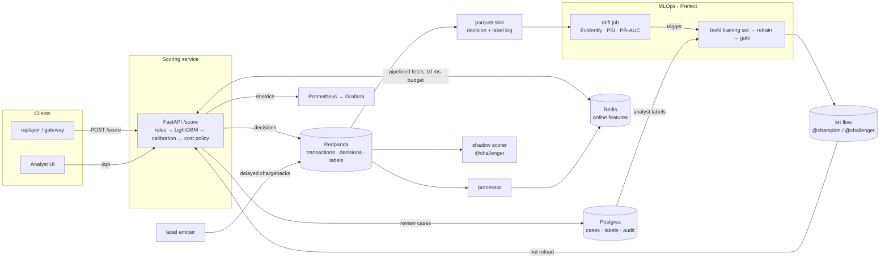

# FraudShield

**A real-time card-fraud detection service, built the way a production system would be.** Every transaction gets an approve / review / block decision in milliseconds, with three reasons an analyst can read. Features are point-in-time correct and computed identically online and offline. Behind the API:
- streaming feature updates;
- a champion/challenger MLOps loop with a promotion gate and rollback;
- drift monitoring that triggers retraining;
- an analyst UI whose labels flow back into training.

It runs on a 16 GB laptop, trims down to 8 GB, and ships as a single demo container that uses under 1 GB.



## Headline numbers

Every value below is written by a `make` target into [`reports/`](reports/) and copied here by `make readme`; nothing is typed in by hand. Model rows are the IEEE-CIS champion on its held-out test window (the last 26 days, after a 7-day label-delay gap). The champion's load test replays that window through the full stack; the second load test and the in-process benchmark use a synthetic model of production size (500 trees × 63 leaves), and the demo container runs a small model trained on the committed CC0 sample.

<!-- metrics:start: generated by `make readme` from reports/; do not edit by hand -->

| Area | Metric | Value | Source |
|---|---|---|---|
| Model | PR-AUC, test window (IEEE-CIS) | 0.501 (rules-only 0.036) | [metrics.json](reports/ieee_cis/metrics.json) |
| Model | Recall at 1 % false-positive rate | 43.9% (rules-only 0.0%) | [metrics.json](reports/ieee_cis/metrics.json) |
| Model | Net savings vs approve-all, test window | $293,050 | [metrics.json](reports/ieee_cis/metrics.json) |
| Serving | Single-request scoring p95, in-process (500 trees) | 6.6 ms (degraded path 2.8 ms) | [serving_inprocess.md](reports/benchmarks/serving_inprocess.md) |
| Serving | Load test, IEEE-CIS champion, 50 req/s target (3 reason codes) | 46.9 req/s, 0 failed, p95 60.0 ms client / 59.0 ms service | [report.md](reports/loadtest-ieee_cis/report.md) |
| Serving | Requests on a fallback path under that load (IEEE-CIS champion) | 0.1% | [report.md](reports/loadtest-ieee_cis/report.md) |
| Resilience | Redis killed mid-load (IEEE-CIS champion) | 0 failed requests; degraded scoring, recovered in 3 s after restart | [report.md](reports/loadtest-ieee_cis/report.md) |
| Serving | Load test, synthetic 500x63 model, 100 req/s target (3 reason codes) | 100.6 req/s, 0 failed, p95 14.0 ms client / 12.0 ms service | [report.md](reports/loadtest/report.md) |
| Serving | Requests on a fallback path under that load (synthetic 500x63 model) | 0.2% | [report.md](reports/loadtest/report.md) |
| Resilience | Redis killed mid-load (synthetic 500x63 model) | 0 failed requests; degraded scoring, recovered in 2 s after restart | [report.md](reports/loadtest/report.md) |
| Monitoring | Drift demo (injected fraud ring): detection | 60% of top-20 features drifted, score PSI 0.21, matured PR-AUC -35% → retrain triggered | [demo-summary.md](reports/drift/demo-summary.md) |
| Monitoring | Daily drift job on the real IEEE-CIS test window (no injection) | 9 of 25 days would retrain (feature drift 3, performance 8, score drift 1) | [daily.md](reports/drift-ieee_cis/daily.md) |
| Deployment | Single-container demo, peak memory | 199 MiB at 50 tx/s for 3 min (limit 1,024 MiB) | [demo-check.md](reports/demo/demo-check.md) |
| Deployment | README quickstart: fresh clone to a working demo | 4.2 min (cold build; base images cached) | [quickstart.md](reports/demo/quickstart.md) |

<!-- metrics:end -->

## Try it in ~10 minutes (demo mode)

You need **Docker** (Docker Desktop, or Engine with Compose v2.24+), about 4 GB of free disk and an internet connection. Python, Node and `make` are not needed.

<!-- quickstart:start -->
```bash
git clone https://github.com/MfmRifath/FraudShield.git && cd FraudShield
docker compose -f compose.demo.yml up -d --build --wait
```
<!-- quickstart:end -->

The first build takes a few minutes: it compiles the UI and trains a small demo model inside the image. Then open **http://localhost:8088** (set `FS_DEMO_PORT` if that port is taken):

- **Live feed:** transactions stream in, five per second, each with a decision, a calibrated probability and its top reason.
- **Review queue:** cases sorted by expected loss. Press `F` (fraud), `L` (legit) or `E` (open the case).
- **Case detail:** the reasons with value vs typical, the card's last 20 events, other cards on the same device or email domain, and the audit trail.
- **Policy simulator:** change the chargeback fee or the daily review capacity and watch the decisions and the net savings change.
- **API:** `curl localhost:8088/api/monitoring/summary`. Interactive docs are at http://localhost:8088/api/docs.

Stop it with `docker compose -f compose.demo.yml down`. The demo is one process: the API, an in-process replayer of the CC0 Sparkov sample, in-memory stores and the UI ([single-container guide](docs/deploy/single-container.md)).

## Architecture



The score path, the feature-store layout, fallbacks, the streaming topology and the deployment shapes are covered in [docs/architecture.md](docs/architecture.md).

## What's inside

| Area | What it does | Where |
|---|---|---|
| Data | IEEE-CIS (primary) and Sparkov adapters into one canonical, validated schema; strict event order; content-hashed manifests | `adapters/`, `schema.py`, ADR-0004 |
| Features | Declarative, point-in-time features (81 for IEEE-CIS, 48 for Sparkov: velocity windows, distinct cards per device/email, first-seen flags, label-delay-aware target encodings); one spec run by a Polars/DuckDB offline executor and a pure online executor | `features/`, ADR-0005/0006 |
| Model and policy | Rules baseline, logistic, LightGBM full + request-only fallback; isotonic/Platt calibration; expected-cost approve/review/block with a daily review capacity; grouped reason codes from `pred_contrib` | `training/`, ADR-0008 |
| Serving | FastAPI scoring with a feature timeout, failure-rate circuit breaker, degraded and rules-only fallbacks (never a 5xx), canary routing, hot reload, SSE, Prometheus metrics | `serving/`, ADR-0009/0014 |
| Streaming | Redpanda + Quix Streams workers: processor (Redis features), label emitter (delayed chargebacks), Parquet sink, shadow scorer | `streaming/`, ADR-0010 |
| MLOps | Point-in-time training set (chargebacks ∪ analyst labels), MLflow aliases with history, a 4-check promotion gate, rollback, Prefect schedules | `mlops/`, `flows/`, ADR-0011 |
| Monitoring | Daily drift job (Evidently feature drift, score PSI, matured-label PR-AUC) that triggers retraining; 5 alert rules; 4 generated Grafana dashboards | `monitoring/`, ADR-0012 |
| Analyst UI | React + TanStack Query + Recharts: live feed, review queue, case detail, model & monitoring, policy simulator; labels → Postgres → training | `ui/`, `cases/`, ADR-0013 |
| Operations | Locust load test, lite 8 GB profile, single-container demo, multi-arch images, CD to a VM, weekly CT, runbook | `loadtest/`, `.github/`, ADR-0014 |

## Evaluation methodology

How the model is judged, so the numbers mean what they claim:

- **Time-based splits with label-delay gaps.** IEEE-CIS days: train 1–120, validation 128–150, test 158–183. The 7-day gaps exceed the simulated chargeback delay, so no label from a later window leaks into training. Tuning uses rolling-origin CV inside the training window only (ADR-0004/0008).
- **Point-in-time features.** Window features use only events strictly before the scored one. Target encodings use labels that were *available* by the previous midnight (hash-based delay of 1–7 days, ADR-0005). Property tests (Hypothesis) check for no leakage against a brute-force oracle.
- **Online = offline.** The same feature specs run in both executors. Replaying a fixture through the online path (in-memory and Redis stores, in process and on the live stack) must match the offline features within 1e-6.
- **Metrics that match the job.**
  - PR-AUC, recall at 0.1 / 0.5 / 1 % false-positive rate, and card precision@k for the review queue;
  - **dollar outcomes** under an explicit cost matrix with a daily review capacity, against approve-all and the rules-only baseline;
  - a cost-sensitivity sweep, because the costs are assumptions (`configs/costs.yaml`).
- **Calibration** is fitted on validation only and checked with reliability plots. Decisions use the calibrated probability.
- **Baselines** are reported alongside: hard rules, logistic regression, and the request-only model (the fallback's quality is known before it is ever needed).
- **Promotion gate.** A challenger replaces the champion only if all four checks pass:
  - PR-AUC within 0.005 of the champion's;
  - net savings at least the champion's;
  - single-row p95 ≤ 5 ms;
  - online/offline parity on the serving feature set.

  A shadow comparison on live traffic is reported but does not gate.

All of this is rendered into the [model card](docs/model_card.md) by `make docs`, which also fills the model rows above. Ranking metrics are computed on the raw model score (isotonic calibration merges scores into ties, which would understate them); calibration and dollar figures use the calibrated probability. Architecture details: [docs/architecture.md](docs/architecture.md). Demo recording plan: [docs/demo-video-script.md](docs/demo-video-script.md).

## Running the full system

| Command | Starts | Open |
|---|---|---|
| `make up` | core: Redpanda, Redis, API, stream workers | API http://localhost:8000/docs · Console http://localhost:8080 |
| `make up-mlops` | + Postgres, MLflow, Prefect server and worker | MLflow http://localhost:5050 · Prefect http://localhost:4200 |
| `make up-ui` | + analyst UI (nginx, cases in Postgres) | http://localhost:5180 |
| `make up-all` | everything, incl. Prometheus and Grafana | Grafana http://localhost:3000 · Prometheus http://localhost:9090 |
| `make up-lite` | trimmed for 8 GB: no Postgres or Prefect server, MLflow on SQLite | as above |
| `make replay RATE=50 ARGS="--max-events 300"` | replays the CC0 fixture through Kafka | Live feed |
| `make mlops-demo` | retrain → @challenger → gate + shadow → promote → rollback, on synthetic data | |
| `make drift-demo` | normal traffic, then a 40 % "fraud ring" → drift alert → retrain | Grafana, `reports/drift/` |
| `make loadtest` | Locust: normal / no reason codes / Redis killed → `reports/loadtest/` | |
| `make down` / `make down-v` | stop (and delete volumes) | |

Until the real training run, the stack serves small models trained on the committed fixture (`make dev-bundle`). The full workflow on the real datasets:

```bash
make data features DATASET=ieee_cis   # Kaggle token + accepted competition rules required
make tune train docs DATASET=ieee_cis # MLflow @challenger, reports/ieee_cis/, docs/model_card.md
make promote DATASET=ieee_cis && make readme
```

Deployment: [Arm VM behind Caddy (TLS + login)](docs/deploy/arm-vm.md) · [single container](docs/deploy/single-container.md) · [runbook](docs/runbook.md).

## Design decisions

| ADR | Decision |
|---|---|
| [0001](docs/adr/0001-stack-choice.md) | Technology stack (Polars/DuckDB, LightGBM, FastAPI, Redpanda + Quix, Redis, MLflow aliases, Prefect, Evidently) |
| [0002](docs/adr/0002-dependency-policy.md) | Exact pins, dependencies added in the phase that needs them |
| [0003](docs/adr/0003-configuration.md) | One validated config: pydantic-settings + YAML, env overrides |
| [0004](docs/adr/0004-event-time-and-entities.md) | Event time, reconstructed entity ids, a strict event order |
| [0005](docs/adr/0005-label-delay-and-target-encoding.md) | Simulated label availability and point-in-time target encoding |
| [0006](docs/adr/0006-feature-library-design.md) | Declarative feature specs with reproducibility hashes |
| [0008](docs/adr/0008-modeling-policy-and-packaging.md) | Calibrated LightGBM, cost-based policy, pickle-free model bundles |
| [0009](docs/adr/0009-serving-design.md) | Serving: feature budget, fallbacks, never a 5xx |
| [0010](docs/adr/0010-streaming-design.md) | Streaming topology keyed by card; Redis feature store |
| [0011](docs/adr/0011-mlops-loop.md) | Training set, registry history, promotion gate, Prefect |
| [0012](docs/adr/0012-monitoring-and-drift.md) | Drift detection, alerts, dashboards as code |
| [0013](docs/adr/0013-analyst-ui-and-case-store.md) | Analyst UI, case store, the label path |
| [0014](docs/adr/0014-hardening-and-deployment.md) | What load testing broke and how it was fixed; lite, demo, delivery |
| [0015](docs/adr/0015-real-data-findings.md) | What the real-data runs changed: raw-score metrics, gate latency, explanation cost, lagged drift check |

All 15 are indexed in [docs/adr/](docs/adr/README.md).

## Development

```bash
make setup        # uv sync (locked) + pre-commit hooks; Python 3.12 via uv
make lint test    # ruff, mypy --strict, pytest (unit + parity + smoke)
make test-docker  # the same in a Linux container (macOS without libomp)
make ui-test      # tsc + vitest (Node 24)
make help         # every target
```

Tests:
- unit, property (Hypothesis) and parity tests;
- training smoke tests;
- API contract and fallback tests;
- compose integration tests per profile (`make test-integration-all`);
- UI component tests.

Every dependency is pinned exactly, and CI pins its actions by commit SHA.

## Limitations and next steps

- **One honest test window.** Model quality is measured once, on the last 26 days of IEEE-CIS. The full model does not beat the request-only one there (PR-AUC 0.501 vs 0.502): IEEE-CIS's anonymised C/D/V columns already encode card history, so the engineered history features (22 % of the gain) add little on this dataset.
- **Explanations are the expensive part.** Prediction takes 0.15 ms (p95), but TreeSHAP reason codes on the tuned model (705 trees × 153 leaves) take about 25 ms per request. Serving capacity on the real model is set by explanations, not prediction.
- **Simulated labels.** Chargeback delays are drawn from a uniform 1–7-day distribution keyed by transaction. Real delays are longer and heavy-tailed, and some fraud is never reported.
- **IEEE-CIS timestamps are synthetic** (an offset from a reference date) and its card ids are reconstructed, so time-of-day features and entity histories are approximations.
- **Costs are assumptions.** The policy is only as good as `configs/costs.yaml`; the simulator and the sensitivity sweep make that visible, but they do not remove it.
- **Single-node serving.** One API worker with a model thread pool. Scaling out needs a shared case store (Postgres, in place) and per-replica canary state; Kafka partitions by card already allow parallel stream workers.
- **Redis state is not rebuilt after a loss** except by new traffic. A backfill that writes feature state without scoring is the next operational tool to build.
- **No authentication in the app itself.** The UI is meant to sit behind the deployment's auth proxy (Caddy basic auth in the VM guide); per-analyst identities and roles would come next.
- **Next:** approximate nearest-neighbour "similar cases" for analysts, per-segment thresholds, and online learning of the review-capacity policy.

## License

MIT: see [LICENSE](LICENSE).
