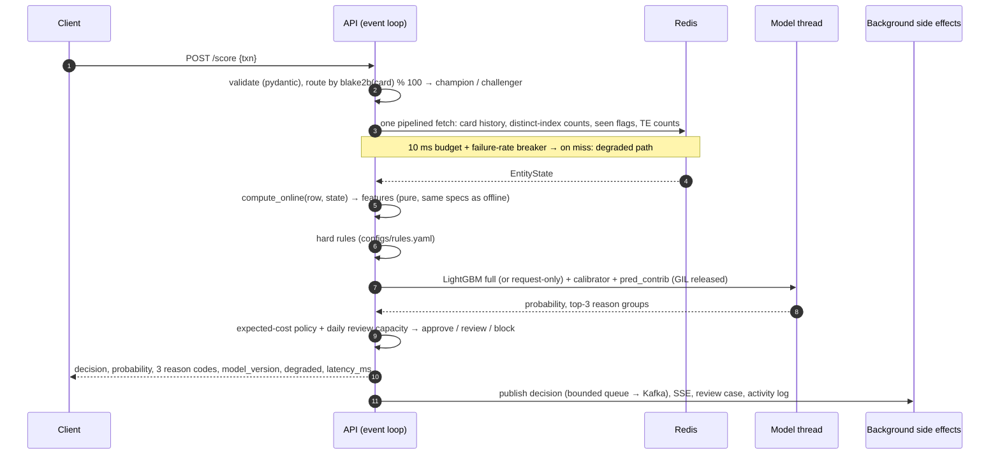
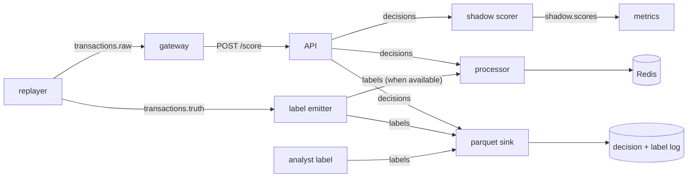
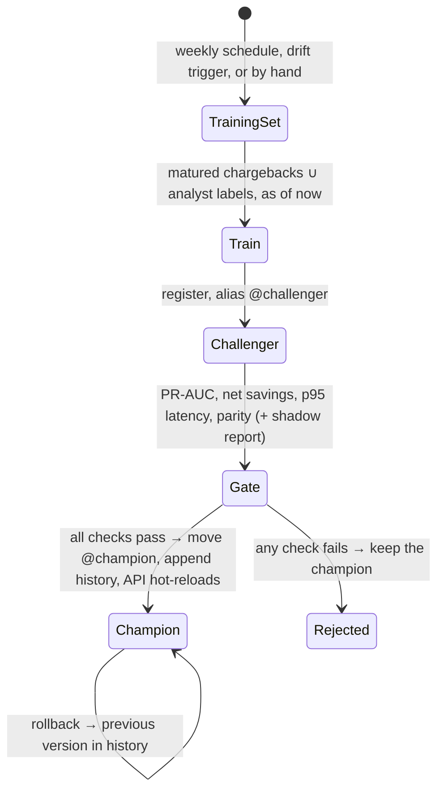

# FraudShield architecture

How the pieces fit, what happens on the hot path, and where state lives. Design rationale is in the ADRs linked from each section.

## 1. Components

| Component | Code | Runs as | State |
|---|---|---|---|
| Dataset adapters → canonical frame | `adapters/`, `schema.py` | batch (`make data features`) | `data/interim/<ds>/transactions.parquet` + manifests |
| Feature library (specs + offline executor) | `features/definitions.py`, `features/offline.py` | batch | `data/processed/<ds>/features.parquet` |
| Training, calibration, policy, packaging | `training/` | batch / Prefect flow | MLflow runs; `ModelBundle` (text boosters + JSON, no pickles) |
| Scoring API | `serving/` | `api` container (FastAPI, 1 uvicorn worker + model thread pool) | in-process: model slots, breaker, canary %, metrics |
| Online feature store | `features/online.py`, `features/store.py`, `features/redis_store.py` | Redis (or in-memory) | per-card history, distinct-value indexes, seen sets, TE counts |
| Stream workers | `streaming/` | `processor`, `gateway`, `label-emitter`, `parquet-sink`, `shadow` | Kafka offsets; Parquet decision/label log |
| MLOps loop | `mlops/`, `flows/` | Prefect worker (weekly retrain, daily drift) | MLflow registry: `@champion`, `@challenger`, `champion_history` |
| Monitoring | `monitoring/`, `infra/prometheus`, `infra/grafana` | Prefect flow + Prometheus + Grafana | `reports/drift/latest.json`, Prometheus TSDB |
| Analyst UI and cases | `ui/`, `cases/` | nginx (static build, `/api` proxy) + API | Postgres `cases`, `labels`, `audit_log` |
| Demo | `demo.py` | one container | all in memory |

## 2. The score path

`POST /score` (`serving/scorer.py`). The answer never depends on Kafka, Postgres or the UI; those are side effects after the response is computed.

**Fallbacks** (ADR-0009, ADR-0014). They are recorded in `fallback_total{reason}`; `/score` never returns a 5xx for internal faults.

| Condition | Path | Response |
|---|---|---|
| store timeout / error / breaker open | request-only booster from the same bundle | `degraded: true`, `fallback: feature_timeout \| feature_store_error \| circuit_open` |
| model error, no model loaded | hard rules only | `probability: null`, `variant: rules_only` |
| anything unexpected | route to a human | `decision: review`, `fallback: internal_error` |
| review capacity used up today | cheaper of approve / block by expected cost | `fallback: review_capacity` (a policy outcome) |

The breaker opens when at least 50 % of at least 10 calls in a 2 s window fail. It stays open for 5 s, then allows one trial call.

## 3. Features and the online store

One declarative spec list (`features/definitions.py`) is interpreted by two executors with identical semantics:
- windows `(t − w, t]` including the current event;
- target encodings from the daily 00:00 UTC snapshot of labels available by then.

Parity is tested to 1e-6 on both stores, in process and on the live stack.

`OnlineSpec` (derived from the specs) tells a store what to keep. Redis layout, all written by `_RedisOps` so the async reader and the sync writer agree:

| Key | Type | Used for |
|---|---|---|
| `fs:h:uid:<card>` | ZSET (score = event µs, member = event JSON) | amount windows (count / sum / mean / max over 10 m … 7 d) |
| `fs:d:<entity>:<col>:<key>` | ZSET (member = value, score = last seen µs) | distinct counts: one `ZCOUNT (t−w, t)` per window + `ZSCORE` for the current value |
| `fs:last:uid:<card>` | string | time since the card's last event |
| `fs:seen:<entity>:<col>:<key>` | SET | first-seen flags (new device / email / address for this card) |
| `fs:te:<col>:<value>`, `fs:te:__all__` | HASH (`<visible day>:n` / `:p`) | target encodings as of the event's snapshot |
| `fs:activity:<card>` | LIST (last 50) | the UI's card timeline |

Reads for one event are a single pipelined round trip. Writes happen after scoring:
- in the stack, by the **processor** from the `decisions` topic, so per-card order holds (topics are keyed by card);
- in single-process mode, by the API itself.

Labels update target encodings from their visible snapshot. Only chargebacks count: analyst labels go to training, not to online features (ADR-0013).

## 4. Streaming topology

- Every topic is keyed by card (`uid`).
- The label emitter holds each truth record until the replay's event-time watermark passes its simulated availability time, so labels arrive late, the way chargebacks do.
- `make replay --drift SHARE` injects a "fraud ring" (shared devices and email, inflated amounts) for the drift demo.

## 5. MLOps loop

- **Drift job** (daily): it compares the last week of served features (from the decision log) with the week before. It runs Evidently feature drift on the champion's top-20 features, score PSI and matured-label PR-AUC; crossing any threshold runs the retrain flow and sets `drift_detected`, which Prometheus turns into an alert.
- **Canary:** `fraudshield canary N` sends N % of cards (stable hash) to `@challenger` live. The shadow worker scores every decision with the challenger without affecting answers.

## 6. Deployment shapes

| Shape | Files | For |
|---|---|---|
| Full stack | `compose.yml` profiles `core`, `mlops`, `monitoring`, `ui` | a 16 GB laptop or a VM |
| Lite | `+ compose.lite.yml` | 8 GB: no Postgres, no Prefect server (ephemeral API), MLflow on SQLite |
| Public VM | `+ infra/deploy/compose.vm.yml` | only Caddy (TLS + basic auth) is public; operator UIs on localhost via SSH |
| Demo | `compose.demo.yml` / image target `demo` | one container, < 1 GB, any container host |

CD (`.github/workflows/cd.yml`) builds `api`, `trainer`, `demo`, `ui` and `mlflow` for amd64 and arm64, pushes them to GHCR, and can deploy to the VM with `docker compose pull && up`. CT (`ct.yml`) triggers the weekly retrain on the deployed Prefect server.

## 7. Time and data model

- **IEEE-CIS:** `event_time = 2017-12-01 + TransactionDT` seconds; card id `card1_addr1_D1n`, with `D1n = floor(TransactionDT / 86400) − D1`.
- **Sparkov:** event times as given; card id = `cc_num`.
- **Order:** strict, by event time, with ties broken by transaction id at µs resolution.
- **Labels:** each becomes available at `event_time + delay(txn_id)`, with a deterministic 1–7-day delay. Features and training sets only use labels available at the time in question (ADR-0004/0005).
