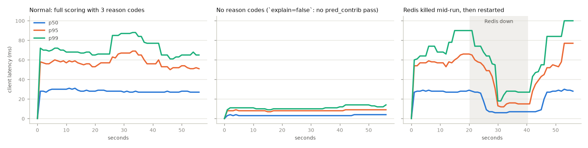
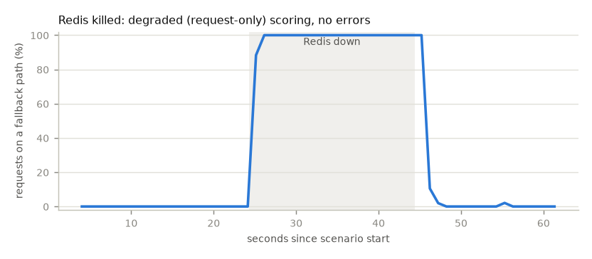

# Load test

Generated 2026-10-25T09:53:03+00:00 by `make loadtest` (`python -m fraudshield.loadtest`). Rerun it to refresh every number on this page.

- **Load:** 25 Locust users x 2.0 req/s (Poisson arrivals) = **50 req/s target**, 60 s per scenario after a 30 s warm-up. 70 % of requests come from returning cards, the rest from never-seen cards; the API stamps server time.
- **Model:** the trained `ieee_cis` model (trained 2026-10-25T09:34:40+00:00, git `6328bc97bb15`), 705 trees (mean 153.0 leaves/tree), 81 features. Payloads are that dataset's held-out test window, as served.
- **System under test:** the compose `core` stack (API: 1 uvicorn worker, 768 MiB limit; Redis feature store; Kafka publishing; processor and shadow scorer consuming).
- **Machine:** Darwin arm64 host, Docker Docker Desktop (aarch64), 12 CPUs, 7.7 GiB. Locust runs on the same machine.

| Scenario | Requests | Achieved req/s | Failed | Client p50 / p95 / p99 (ms) | Service p50 / p95 / p99 (ms) | Fallback share |
|---|---:|---:|---:|---|---|---:|
| Normal: full scoring with 3 reason codes | 2,673 | 46.9 | 0 | 28.0 / 60.0 / 93.0 | 27.0 / 59.0 / 88.0 | 0.1 % |
| No reason codes (`explain=false`: no pred_contrib pass) | 2,849 | 49.9 | 0 | 3.0 / 9.0 / 29.0 | 2.0 / 5.0 / 7.0 | 0.2 % |
| Redis killed mid-run, then restarted | 2,734 | 47.8 | 0 | 26.0 / 57.0 / 100.0 | 26.0 / 55.0 / 98.0 | 38.0 % |

*Client* = Locust, request sent to response read, over the compose network. *Service* = the `latency_ms` the API reports (validation to response). *Failed* = non-200 responses or client errors. *Fallback share* = requests answered on a fallback path (`review_capacity` excluded: it is a policy outcome).

## Normal: full scoring with 3 reason codes

- Decisions: approve 2,362, block 333.
- Fallbacks by reason: `feature_timeout` 2, `review_capacity` 566.
- Server histogram (Prometheus buckets, coarse): p50 / p95 / p99 = 36.6 / 76.0 / 99.2 ms.
- API container mid-run: 169.9MiB / 768MiB memory, 138.33% CPU.

## No reason codes (`explain=false`: no pred_contrib pass)

- Decisions: approve 2,539, block 327.
- Fallbacks by reason: `feature_timeout` 5, `review_capacity` 598.
- Server histogram (Prometheus buckets, coarse): p50 / p95 / p99 = 2.0 / 4.9 / 9.1 ms.
- API container mid-run: 169.4MiB / 768MiB memory, 13.69% CPU.

## Redis killed mid-run, then restarted

Redis was killed 20 s into the load and started again 20 s later. The fallback share was back under 5% 3 s after the restart.

- Decisions: approve 2,395, block 358.
- Fallbacks by reason: `circuit_open` 986, `feature_store_error` 48, `feature_timeout` 13, `review_capacity` 614.
- Server histogram (Prometheus buckets, coarse): p50 / p95 / p99 = 26.7 / 66.3 / 98.7 ms.

## Caveats

- One laptop runs the load generator, the API, Redis, Redpanda and the stream workers, so they compete for CPU; a dedicated host would show lower tails.
- Locust's per-second percentiles (charts) use its 10 s sliding window; the table uses all requests of the scenario.
- The decision mix says nothing about the policy: each returning card transacts every few seconds (the burst pattern the synthetic model learnt as fraud), and the 200/day review capacity is used up within seconds, after which reviews become approve/block (`review_capacity`).
- The real-model rerun (IEEE-CIS champion, test-window payloads) is in PLAN.md "Deferred real-data runs".
