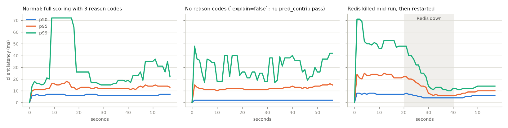
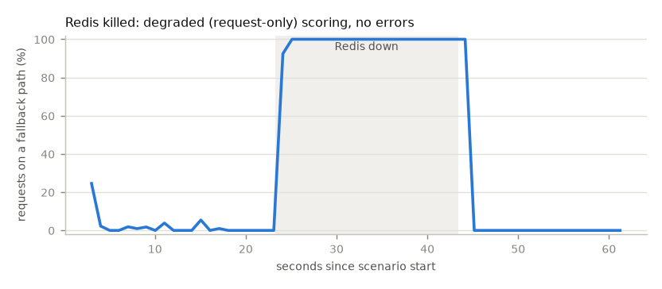

# Load test

Generated 2026-10-24T14:41:59+00:00 by `make loadtest` (`python -m fraudshield.loadtest`). Rerun it to refresh every number on this page.

- **Load:** 50 Locust users x 2.0 req/s (Poisson arrivals) = **100 req/s target**, 60 s per scenario after a 30 s warm-up. 70 % of requests come from returning cards, the rest from never-seen cards; the API stamps server time.
- **Model:** `synthetic-500x63`, 500 trees (mean 63.0 leaves/tree), 48 features. A *synthetic* bundle of production-like size: it measures the serving path, not model quality.
- **System under test:** the compose `core` stack (API: 1 uvicorn worker, 768 MiB limit; Redis feature store; Kafka publishing; processor and shadow scorer consuming).
- **Machine:** Darwin arm64 host, Docker Docker Desktop (aarch64), 12 CPUs, 7.7 GiB. Locust runs on the same machine.

| Scenario | Requests | Achieved req/s | Failed | Client p50 / p95 / p99 (ms) | Service p50 / p95 / p99 (ms) | Fallback share |
|---|---:|---:|---:|---|---|---:|
| Normal: full scoring with 3 reason codes | 5,842 | 100.6 | 0 | 6.0 / 14.0 / 51.0 | 6.0 / 12.0 / 40.0 | 0.2 % |
| No reason codes (`explain=false`: no pred_contrib pass) | 5,663 | 99.2 | 0 | 2.0 / 13.0 / 45.0 | 1.0 / 10.0 / 19.0 | 0.5 % |
| Redis killed mid-run, then restarted | 5,688 | 98.0 | 0 | 6.0 / 17.0 / 52.0 | 5.0 / 14.0 / 43.0 | 38.4 % |

*Client* = Locust, request sent to response read, over the compose network. *Service* = the `latency_ms` the API reports (validation to response). *Failed* = non-200 responses or client errors. *Fallback share* = requests answered on a fallback path (`review_capacity` excluded: it is a policy outcome).

## Normal: full scoring with 3 reason codes

- Decisions: approve 1,849, block 4,003.
- Fallbacks by reason: `feature_timeout` 9, `review_capacity` 1,171.
- Server histogram (Prometheus buckets, coarse): p50 / p95 / p99 = 6.8 / 15.0 / 42.1 ms.
- API container mid-run: 167.7MiB / 768MiB memory, 53.86% CPU.

## No reason codes (`explain=false`: no pred_contrib pass)

- Decisions: approve 1,600, block 4,152.
- Fallbacks by reason: `feature_timeout` 29, `review_capacity` 1,082.
- Server histogram (Prometheus buckets, coarse): p50 / p95 / p99 = 1.7 / 11.0 / 19.7 ms.
- API container mid-run: 167.8MiB / 768MiB memory, 25.06% CPU.

## Redis killed mid-run, then restarted

Redis was killed 20 s into the load and started again 20 s later. The fallback share was back under 5% 2 s after the restart.

- Decisions: approve 2,997, block 2,703.
- Fallbacks by reason: `circuit_open` 2,027, `feature_store_error` 113, `feature_timeout` 48, `review_capacity` 1,098.
- Server histogram (Prometheus buckets, coarse): p50 / p95 / p99 = 5.1 / 17.0 / 45.0 ms.

## Caveats

- One laptop runs the load generator, the API, Redis, Redpanda and the stream workers, so they compete for CPU; a dedicated host would show lower tails.
- Locust's per-second percentiles (charts) use its 10 s sliding window; the table uses all requests of the scenario.
- The decision mix says nothing about the policy: each returning card transacts every few seconds (the burst pattern the synthetic model learnt as fraud), and the 200/day review capacity is used up within seconds, after which reviews become approve/block (`review_capacity`).
- The real-model rerun (IEEE-CIS champion, test-window payloads) is in PLAN.md "Deferred real-data runs".
